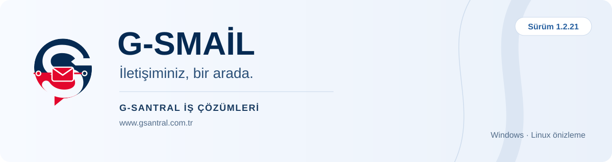
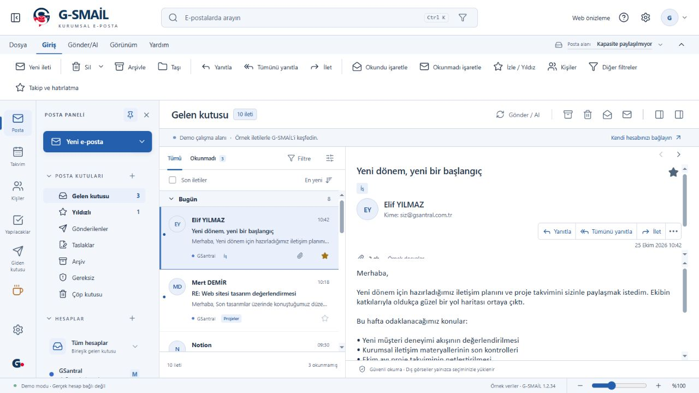
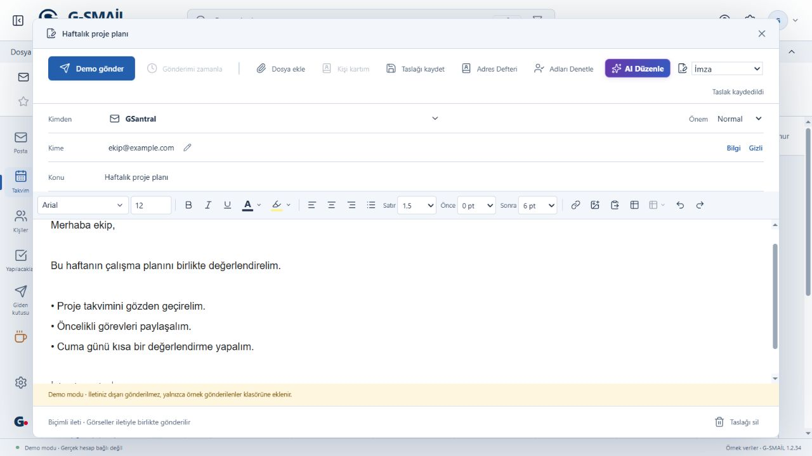
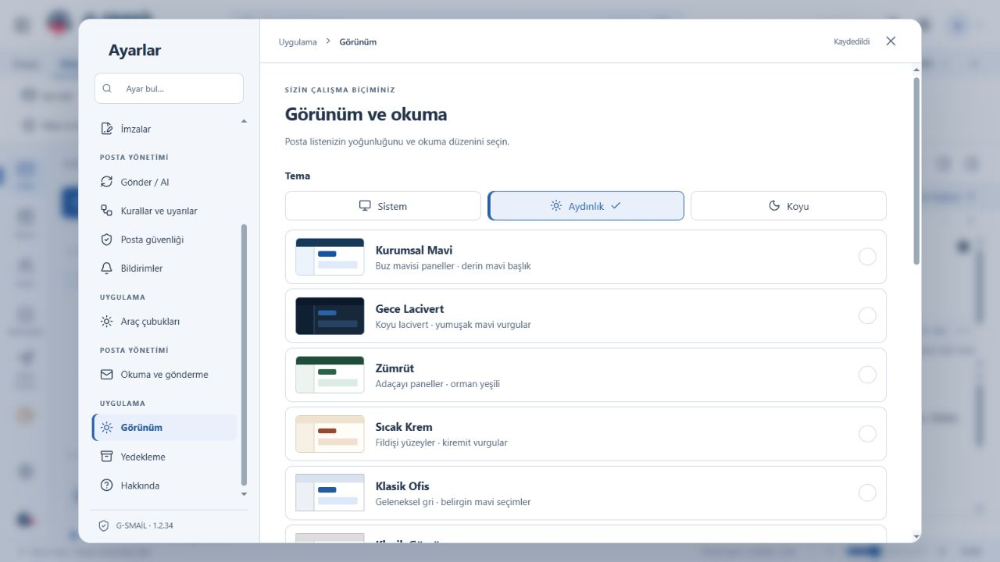
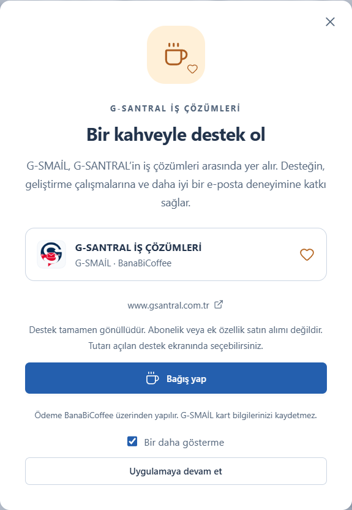

<b>Türkçe arayüz · Windows masaüstü · Linux önizleme</b> Birden fazla e-posta hesabı için düzenli bir çalışma alanı.

<a href="https://github.com/gokhanbarisboz/G-SMail/releases/latest"><b>⬇ Son sürümü indir</b></a> · <a href="docs/KURULUM.md">Kurulum rehberi</a> · <a href="https://www.gsantral.com.tr">G-SANTRAL</a> · <a href="https://banabicoffee.com/@gsmail">☕ Bir kahveyle destek ol</a>

## E-postalarınıza daha rahat odaklanın

**G-SMAİL**, G-SANTRAL İŞ ÇÖZÜMLERİ’nin masaüstü e-posta uygulamasıdır. Hesaplarınızı bir araya getirir; iletilerinizi okumanızı, düzenlemenizi ve takip etmenizi kolaylaştırır.

Bu depoda **hazır uygulama paketleri, örnek ekranlar ve kullanım belgeleri** bulunur. Uygulamanın kaynak kodu yayımlanmaz.

## Günlük kullanım için

| Özellik | Ne sağlar? |
|---|---|
| Birden fazla hesap | Postalarınızı tek çalışma alanında takip edin. |
| Rahat okuma | İleti tablolarını, görsellerini ve eklerini inceleyin; okuma alanını ihtiyacınıza göre ayarlayın. |
| Düzenli gelen kutusu | Klasörler, yıldızlar, arama ve yerel kurallarla iletilerinizi düzenleyin. |
| Biçimli yazışmalar | Zengin metin düzenleyicisi, adlandırılmış imzalar ve taslaklarla e-posta hazırlayın. |
| Yapay zekâ desteği | Kendi sağlayıcınız ve API anahtarınızla metinlerinizi düzenleyin. |
| Size uygun görünüm | Açık/koyu tema, panel boyutları ve metin yakınlaştırmasını seçin. |
| Posta koruması | Gönderen engelleme, gereksiz posta işlemleri ve şüpheli bağlantı uyarılarını kullanın. |
| Yedekleme | Çalışma alanınızı parolalı bir dosyada yedekleyin. |

### Önizlemeler

*Ekranlar, 1.2.34 uygulamasının gerçek arayüzünden örnek verilerle alınmıştır. Gerçek kullanıcı postası veya hesap anahtarı içermez.*

## Hangi paketi indirmeliyim?

Güncel sürüm: **1.2.43**. Dosyalar [sürüm sayfasında](https://github.com/gokhanbarisboz/G-SMail/releases/latest) bulunur.

| Platform | Dosya | Kullanım |
|---|---|---|
| Windows 64 bit | `G-SMail-Setup.exe` | **Önerilen.** Kurulum ve mevcut sürümün üzerine güncelleme. |
| Windows 64 bit | `G-SMail-Portable.exe` | Tek dosyadan kurulumsuz açılış. |
| Linux 64 bit · önizleme | `G-SMail-1.2.43-linux-amd64.deb` | Ubuntu, Linux Mint, Debian ve Pardus için paket kurulumu. |
| Linux 64 bit · önizleme | `G-SMail-1.2.43-linux-x64.tar.gz` | Arşivi çıkarıp `G-SMail/Baslat.sh` ile açın. |

Linux paketlerinin içeriği ve bütünlüğü doğrulandı; gerçek Linux masaüstünde kurulum/çalışma testi henüz yapılmadı. [Kurulum ayrıntıları →](docs/KURULUM.md)

## Hesabınızı bağlayın

Gmail / Google Workspace, Outlook / Microsoft 365, Yahoo, iCloud ve standart IMAP/POP3/SMTP sunucuları için bağlantı seçenekleri vardır. cPanel ve Zimbra için yayımlanmış bağlantı ayarları otomatik bulunur; gerektiğinde gelişmiş alanları kurumunuzun verdiği bilgilerle düzenleyebilirsiniz.

Bağlantı yöntemi, uygulama şifresi ve yönetici izinleri sağlayıcıya göre değişir. Her sağlayıcının bütün servislerinin eksiksiz entegrasyonu vaat edilmez. [Hesap ve yapay zekâ rehberi →](docs/HESAPLAR-VE-YAPAY-ZEKA.md)

## 1.2.43 ile gelenler

- Sunucuda bulunamayan iletilere ait eski taşıma hataları, kaynak ve hedef klasörler denetlenerek uzlaştırılır. Taşıma veya silme işlemi yeniden gönderilmez.
- Hedef klasörde doğrulanamayan bir ileti taşınmış gibi gösterilmez. Yinelenen hata kayıtları önlenir ve çözüm açıklamaları korunur.
- Posta işlemleri geçmişine alt çubuktan ulaşabilirsiniz. Son 200 uzlaştırılmış kayıt, uygulama yeniden açıldığında da saklanır.

## Bir kahveyle destek olmak ister misiniz?

G-SMAİL günlük işlerinizi biraz daha kolaylaştırıyorsa, geliştirme yolculuğumuza bir kahveyle eşlik etmek ister misiniz? ☕

Her destek; uygulamayı geliştirmek, hataları gidermek ve daha rahat bir e-posta deneyimi sunmak için ayırdığımız emeğe katkı sağlar. Kullanmanız, önerileriniz ve geri bildirimleriniz de bizim için çok değerli.

**[☕ G-SMAİL’e bir kahve ısmarla](https://banabicoffee.com/@gsmail)**

Destek sayfamız: [banabicoffee.com/@gsmail](https://banabicoffee.com/@gsmail)

Destek tamamen gönüllüdür; bir abonelik, lisans satın alımı veya ek özellik vaadi değildir. Katkılarınız ve geri bildirimleriniz için teşekkür ederiz.

---

**G-SANTRAL İŞ ÇÖZÜMLERİ** · [www.gsantral.com.tr](https://www.gsantral.com.tr) · [bilgi@gsantral.com.tr](mailto:bilgi@gsantral.com.tr)

Hata veya öneri iletirken sürümü ve işletim sistemini belirtin. Şifre, API anahtarı veya gerçek e-posta içeriklerini herkese açık paylaşmayın.
